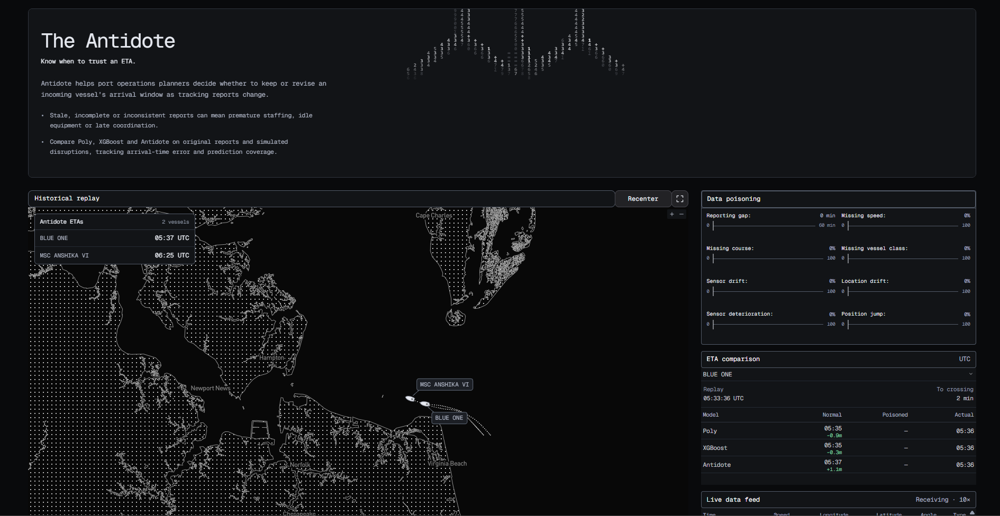
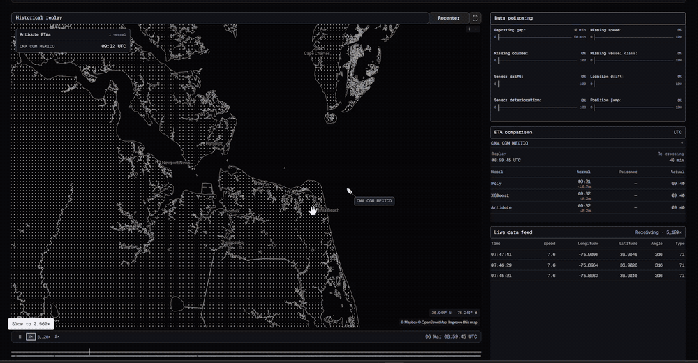
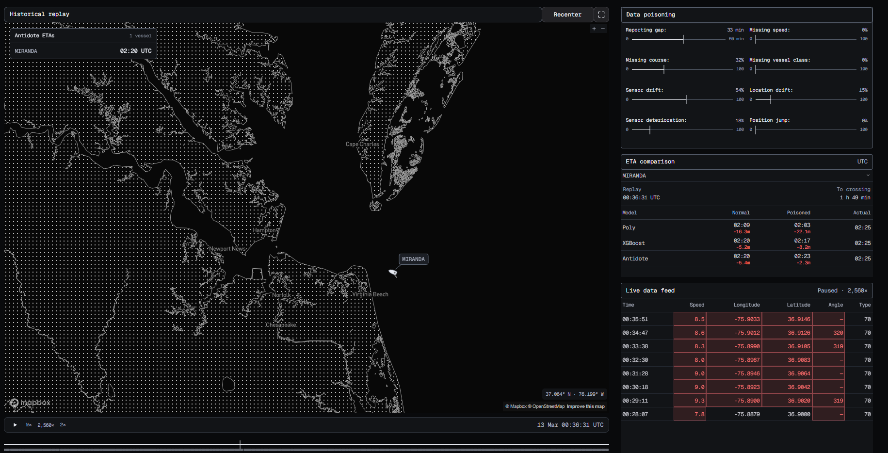
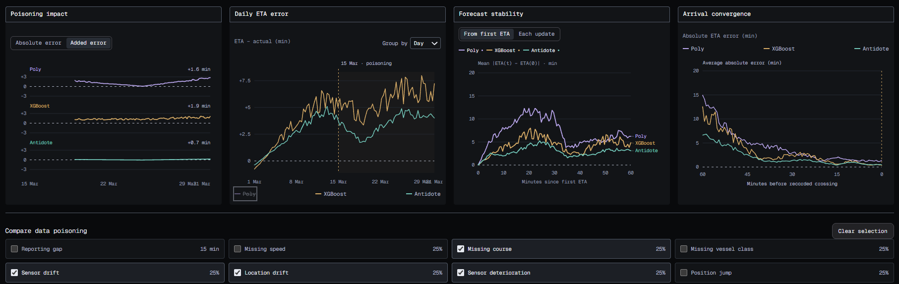
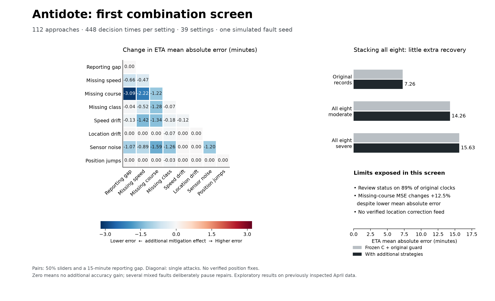
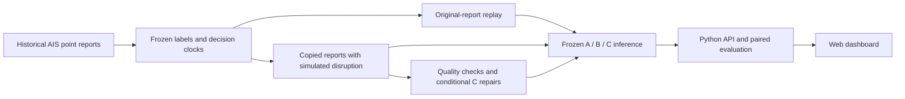

#  The Antidote

### Maritime ETA forecasting under unreliable AIS reports

Antidote is a research prototype for replaying vessel approaches to Hampton Roads, comparing arrival forecasts, and investigating how missing or inconsistent Automatic Identification System (AIS) reports affect those forecasts. It combines frozen machine-learning models, controlled disruption experiments, conditional input repairs, and an interactive web dashboard.




[Application tour](#application-tour) · [Illustrated results](#illustrated-results) · [Research findings](#research-findings) · [Run locally](#run-locally) · [Research record](#research-record)

## What we built

- **A vessel replay dashboard:** geographic fleet view, historical playback, vessel-level ETA comparisons, report history, and anomaly review.
- **Three frozen forecasting systems:** A (quadratic ridge), B (ordinary XGBoost), and C (nominal-only optimized XGBoost in the current serving configuration).
- **Eight disruption controls:** reporting gaps, missing speed, missing course, missing vessel class, speed drift, location drift, sensor noise, and position jumps. Injected cases are examples of actual disruption that can occur in the real-world.
- **Conditional mitigation:** supported speed/course reconstruction, class carry-forward, and selected drift/noise handling. Gap and position-jump strategies can warn without changing a forecast. Coordinate correction requires an independent trusted reference.
- **Auditable evaluation:** fixed arrival labels and decision schedules, artifact integrity checks, paired comparisons, vessel-level uncertainty, and prediction coverage.
- **A research overview:** an HTML presentation plus [PDF](Frontend/research/paper.pdf) and [LaTeX source](Frontend/research/paper.tex). Experiment-specific reports below define the scope of numerical claims.

The arrival target is an analytical harbor-gate crossing, rather than a verified berth or docking time.

## Application tour

### Historical vessel replay

The fleet view places historical reports on a Hampton Roads map. Playback controls and vessel selection connect received reports to model forecasts and the recorded crossing. The opening screenshot shows THISSEAS with disruption controls at zero.

[](docs/media/app-walkthrough.mp4)

### Controlled disruption and comparison

The dashboard compares original and disrupted inputs at the same decision clock. The screenshot below applies **simulated 100% missing speed** to THISSEAS. Changes to experimental controls do not alter the source archive or original arrival labels.



## Illustrated results

The selected dashboard scenario combines **missing course, sensor drift, location drift, and sensor deterioration**, each at **25% strength**. The illustrated disruption begins on **March 15**; reporting gaps, missing speed, missing vessel class, and position jumps are unselected.



The **Poisoning impact → Added error** view displays the following increases in mean absolute ETA error relative to the inital dataset.

| Model | Illustrated added error, minutes ↓ |
| --- | ---: |
| Poly | +1.6 |
| XGBoost | +1.9 |
| Antidote | **+0.7** |

Antidote has the smallest added error in this illustration. The other panels show daily signed ETA error, absolute forecast movement over 60 minutes, and absolute error as the recorded crossing approaches. Poly is hidden in the daily-error panel. These views demonstrate how the interface compares accuracy, stability, and convergence; their curves come from `simulation-graphs.mjs`.

Values are transcribed from the supplied screenshot and rounded as displayed. Screenshots include hosted captures from October 28, 2026 and this user-provided results view. See [media provenance](docs/media/README.md).

**[Watch a brief fleet playback clip](docs/media/fleet-playback.mp4)** · Actual application capture, with the replay running at 10× and all disruption controls at zero. This clip demonstrates interface behavior, rather than serving as an accuracy benchmark.

## Research findings

### Original-report forecasting: nominal C has a small observed advantage

The principal all-nominal comparison uses **243 approaches, 219 vessels, and 5,382 scheduled forecasts per model across March 1–31, 2024**. All models share fitting and tuning decision identities: January 1–June 29, 2023 for fitting, then June 30–July 19 for tuning. This comparison injects no faults.

| Frozen model | MAE, minutes ↓ | Median absolute error, minutes ↓ | P95 absolute error, minutes ↓ | Prediction coverage |
| --- | ---: | ---: | ---: | ---: |
| A · Quadratic ridge | 7.019 | 3.459 | **36.725** | 100% |
| B · Ordinary XGBoost | 6.643 | 3.164 | 37.361 | 100% |
| C · Kelman- optimized XGBoost | **6.010** | **2.797** | 36.097 | 100% |

C improves approach-weighted MAE over B by **0.033 minutes, about 1.97 seconds**, and wins on 133 of 243 approaches (54.7%). The paired vessel-bootstrap 95% interval for C minus B is **−0.125 to +0.050 minutes**, which includes zero. This supports a small observed gain in this cohort without establishing a clear population-level advantage. A has the lowest P95 error.

MAE weights approaches equally; median and P95 pool individual forecast errors. Coverage counts available forecasts against all scheduled decisions. These metrics answer different questions and should be read together.

**Evidence:** [full results](Data_Science/experiments/nominal_model_comparison/RESULTS.md), [machine-readable verification](Data_Science/experiments/nominal_model_comparison/verification.json).

### Repairs help selected faults, with important failure cases

A separate exploratory integration screen uses **vessel-class-v2 models**, **112 April approaches / 110 vessels**, four sampled clocks per approach, **39 settings**, and one fault seed (4201). It compares the same frozen C with its existing guard against C plus dashboard strategies. These are **different models and a different cohort from the March table**.

| Simulated disruption | Antidote with guard: MAE, min | Antidote plus strategies: MAE, min | Change, min [paired 95% interval] |
| --- | ---: | ---: | --- |
| Missing speed | 7.809 | 7.336 | −0.473 [−0.872, −0.087] |
| Missing course | 8.632 | 7.416 | −1.216 [−2.003, −0.175] |
| Sensor noise | 9.096 | 7.901 | −1.195 [−2.244, −0.421] |
| Reporting gap + missing course | 10.478 | 7.385 | −3.093 [−4.285, −1.972] |
| All eight, moderate settings | 14.270 | 14.257 | −0.013 [−0.052, +0.014] |
| All eight, severe settings | 15.631 | 15.631 | 0.000 [0.000, 0.000] |

Sixteen of 28 paired-fault settings reduced average error; twelve were unchanged. Incompatible faults often pause repairs. The severe all-eight case received no additional feature correction, and stacked errors remained well above the original-record MAE of 7.263 minutes.

Aggregate gains hide failures. Missing-course repair lowered MAE but raised MSE from **173.80 to 195.56 min²**. One repaired forecast became **101.25 minutes worse**, largely restoring an existing model weakness. Original records triggered review at **400 of 448 sampled clocks (89.3%)**, indicating a substantial review burden.

April was previously inspected. Intervals are exploratory and unadjusted for multiple comparisons. The runner knows the selected simulated fault families when deciding which repairs are compatible; this does not validate blind fault identification or every slider combination.



*This figure is a saved research result from the exploratory April cohort, separate from the dashboard's illustrative charts and the March benchmark.*

**Evidence:** [findings and failure analysis](Data_Science/experiments/fleet_combinations/results/representative_seed_4201/FINDINGS.md), [complete report](Data_Science/experiments/fleet_combinations/results/representative_seed_4201/REPORT.md), [summary data](Data_Science/experiments/fleet_combinations/results/representative_seed_4201/summary.json).

### Anomaly warnings and forecast improvements are separate outcomes

The position-jump detector compares adjacent positions against motion implied by reported speed and course. It warns without replacing observations or altering A/B/C predictions. An alert does not establish improved ETA accuracy or malicious source data.

For simulated 2 km jumps affecting 10% of the March feed, it flagged **99.12% of assessed affected pairs** and warned on **100% of affected decision windows**. Clean March decision alerts were **1.32%**. Pairs more than 120 seconds apart or lacking usable velocity are unassessed; a coherent offset from the first report can remain undetected. These rates describe the detector experiment, not the combined dashboard's broader review status.

**Evidence:** [detector protocol, results, limitations, and invariance checks](Data_Science/experiments/position_jump_anomaly/results/REPORT.md).

## How it works



Forecasts use evidence received by their decision time. Arrival labels and injected-fault truth belong to evaluation, outside predictor inputs. Repairs retain original observations and missingness signals. Inference and ETA analysis run in Python; the browser renders API outputs. The illustrative preloaded chart path described above is separate.

The portable bundle includes A/B baselines, nominal C, replay data, and an integrity manifest. Startup loads saved artifacts without training or downloading source archives. Only deserialize trusted joblib files.

## Run locally

Use **Python 3.11**. From the repository root:

```powershell
python -m venv Data_Science/.venv
./Data_Science/.venv/Scripts/Activate.ps1
python -m pip install -r Data_Science/requirements.txt
Set-Location Data_Science
python -m Optimized_Model serve --port 8765
```

Open [the dashboard](http://localhost:8765/tracking/) or [the research overview](http://localhost:8765/overview/). The existing CLI serves web assets and API together, defaulting to frozen nominal C and March 2024 evaluation. Opening HTML directly does not start inference.

The tracked bundle lives under `Data_Science/artifacts/data_eval/optimized/`. Restore the matching bundle if files are missing or integrity checks fail. Do not retrain or bypass verification to repair startup.

An optional root `.env` entry, `MAPBOX_PUBLIC_TOKEN=pk.…`, enables the geographic basemap through the CLI's token loader. The interface has a coordinate fallback. Local inference needs no hosting subscription; external map/CDN resources require internet access, so this is not a fully air-gapped package.

For the deployment-style API alone, from `Data_Science`:

```powershell
python -m uvicorn server:app --host 127.0.0.1 --port 8765 --workers 1
```

The FastAPI adapter exposes `/health`, `/api/config`, `/api/fleet/catalog`, `/api/fleet/frame`, `/api/fleet/monthly`, and `/api/fleet/stress`. It needs a separate static frontend/proxy. Use one worker: analysis queues and results live in process memory. A healthy `/health` confirms bundle loading, rather than every UI or analysis behavior.

## Research record

| Area | Source |
| --- | --- |
| Nominal A/B/C benchmark | [Results and model-selection caveats](Data_Science/experiments/nominal_model_comparison/RESULTS.md) |
| 2023 acquisition, splits, augmented C, calibration | [Data evaluation report](Data_Science/experiments/data_eval/RESULTS.md) |
| Combined faults and individual failures | [Integration findings](Data_Science/experiments/fleet_combinations/results/representative_seed_4201/FINDINGS.md) |
| Position anomalies | [Warning-only evaluation](Data_Science/experiments/position_jump_anomaly/results/REPORT.md) |
| Speed/course reconstruction | [Missing speed](Data_Science/experiments/missing_speed_mitigation/results/REPORT.md), [missing course](Data_Science/experiments/missing_course_mitigation/results/REPORT.md) |
| Other mitigation studies | [Sensor noise](Data_Science/experiments/sensor_noise_mitigation/results/REPORT.md), [speed drift](Data_Science/experiments/drift_mitigation/results/REPORT.md), [vessel class](Data_Science/experiments/missing_vessel_class_mitigation/results/REPORT.md) |

Historical studies use several model versions and periods. Consult each protocol before comparing values. Some detailed prediction CSVs and source archives remain locally ignored; the portable bundle supports replay but does not reproduce every historical experiment.

Source data comes from the [NOAA / MarineCadastre AIS point archive](https://www.coast.noaa.gov/htdata/CMSP/AISDataHandler/2023/index.html). Historical observations may contain quality issues. Injected disruptions and proposed repairs are experimental interventions, not NOAA facts. Source delivery timestamps are unavailable, so nominal immediate delivery is an assumption. Track geometries without report timing cannot substitute for AIS point broadcasts.

## Verification

Install development dependencies and run the backend suite from `Data_Science`:

```powershell
python -m pip install -r requirements-dev.txt
python -m pytest tests -q
```

For frontend checks, from `Frontend` with Node.js/npm installed:

```powershell
npm ci
npm run check
npm test
node --test netlify/backend-proxy/proxy.smoke.mjs
```

These are verification entry points, not a claim that every check currently passes. Historical pass counts in reports describe those recorded runs.

## Repository guide

| Path | Contents |
| --- | --- |
| `Frontend/tracking/` | Dashboard and illustrative scenario charts |
| `Frontend/research/` | Overview, PDF, and LaTeX |
| `Data_Science/Optimized_Model/` | Frozen inference, causal replay, fleet service, and local server |
| `Data_Science/server.py`, `Data_Science/api/` | FastAPI adapter and background jobs |
| `Data_Science/attacks/`, `Data_Science/mitigation/` | Simulated disruptions and mitigation policies |
| `Data_Science/experiments/`, `Data_Science/tests/` | Reports, protocols, runners, and regression checks |
| `docs/media/` | Application captures and provenance |

## Project status and next steps

The current work preserves a functioning research interface and a documented experimental record. Scientific priorities are an untouched evaluation cohort, useful calibrated acceptance, lower unsupported-review burden, and investigation of repairs that worsen individual forecasts. Current results do not establish autonomous fault recovery or deployment safety.

Hosting retirement remains a separate step. The committed `render.yaml` describes a paid service; editing documentation does not cancel it. Suspend the backend, disable automatic redeployment, and verify any remaining workspace, disk, or other resource charges before treating billing as stopped. The [previous deployment notes](docs/deployment-history.md) are retained as a historical record and contain outdated status statements.
